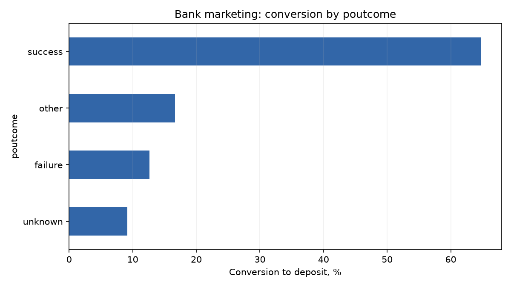
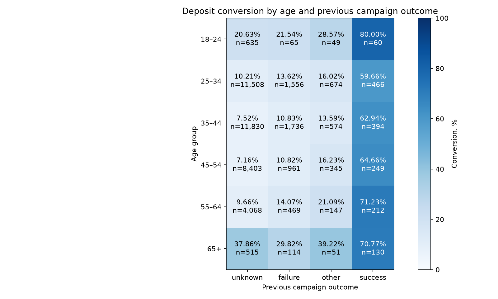

# Анализ банковской маркетинговой кампании

Небольшой учебный проект на данных телефонной кампании португальского банка. Задача — разобраться, как различается конверсия во вклад у разных групп клиентов и что из этого можно использовать для дальнейшего исследования.

Главный вопрос: **сохраняется ли высокая конверсия клиентов с успешной прошлой кампанией, если сравнивать их внутри возрастных групп?**

## Данные

Источник — [UCI Bank Marketing](https://archive.ics.uci.edu/dataset/222/bank+marketing), файл `bank-full.csv`. [Копия на Kaggle](https://www.kaggle.com/datasets/janiobachmann/bank-marketing-dataset).

В таблице 45 211 записей: возраст, занятость, история контактов и результат кампании. Целевая переменная `y` показывает, оформлен ли срочный вклад (`yes` или `no`). Это исторические данные другого банка, не Т-Банка.

Конверсия в проекте — доля записей с `y = yes`. Уникального идентификатора клиента нет, поэтому число строк не трактуется как подтверждённое число уникальных клиентов или отдельных звонков.

## Что входит в анализ

1. Проверка пустых значений, точных дубликатов и значений `unknown`.
2. Расчёт общей конверсии и сравнение по возрасту, занятости и результату предыдущей кампании.
3. Сравнение результатов предыдущей кампании внутри шести возрастных групп.
4. Возрастная стандартизация: пересчёт показателей при одинаковом возрастном составе групп.
5. Проверка расчётов pandas через четыре SQL-запроса на SQLite.

В исходном файле нет пустых ячеек и точных дубликатов строк. Категории `unknown` сохранены отдельно: неизвестный результат прошлой кампании нельзя приравнивать к неудаче. Строки из анализа не удалялись.

## Основные результаты

Вклад оформлен в **5 289 из 45 211 записей — 11,70%**.

| Результат предыдущей кампании | Записей | Оформлений | Конверсия |
|---|---:|---:|---:|
| Успех | 1 511 | 978 | 64,73% |
| Неудача | 4 901 | 618 | 12,61% |
| Другой результат | 1 840 | 307 | 16,68% |
| Неизвестно | 36 959 | 3 386 | 9,16% |



Разница большая, но группы могут отличаться по составу. Поэтому одного сравнения общих процентов недостаточно.

## Может ли разницу объяснить возраст?

В общей выборке возрастные группы заметно отличаются: у записей с возрастом 65+ конверсия 42,10%, а в группе 35–44 — 9,66%. Возник вопрос: не связана ли высокая конверсия при прошлом успехе просто с другим возрастным составом?

Для проверки возраст разбит на шесть интервалов. **В каждом из них конверсия при прошлом успехе выше, чем при остальных результатах кампании.**



Например, в группе 25–34 после прошлого успеха оформлено 278 вкладов в 466 записях — 59,66%. После неудачи — 212 в 1 556, или 13,62%.

Затем конверсия каждого результата пересчитана с одинаковыми весами возрастных групп — их долями в полной выборке:

| Результат ранее | Исходная конверсия | При одинаковом возрастном составе |
|---|---:|---:|
| Успех | 64,73% | 63,63% |
| Неудача | 12,61% | 12,59% |
| Неизвестно | 9,16% | 9,30% |

Разница почти не исчезает. Значит, возрастной состав в выбранных интервалах не объясняет всю наблюдаемую связь. Другие характеристики клиентов и различия внутри самих возрастных интервалов эта проверка не учитывает.

[Подробная таблица, метод и ограничения проверки](age_comparison.md).

## Что можно проверить дальше

История успешного контакта — кандидат для дальнейшего исследования при планировании кампании. Следующий шаг — проверить связь на более позднем независимом периоде и сравнить клиентов с похожими характеристиками. До изменения стратегии нужно также оценить затраты, доходы и результат отдельного эксперимента.

Это не A/B-тест: группы не распределялись случайным образом. Нельзя утверждать, что прошлый успех сам по себе вызывает новое оформление. Он может отражать интерес к продукту или особенности отбора аудитории. Малые группы требуют осторожности: например, показатель 80% у клиентов 18–24 с прошлым успехом получен всего на 60 записях.

Длительность последнего звонка не использована для рекомендаций по выбору аудитории до звонка: в этот момент она ещё неизвестна. Прибыль и статистическая значимость различий в этом проекте не оценивались.

## Как устроен проект

| Файл | Содержание |
|---|---|
| `analysis.py` | Расчёты, графики и сверка SQL с pandas |
| `queries.sql` | Четыре запроса, включая разрез по возрасту и прошлой кампании |
| `bank-full.csv` | Исходный набор данных |
| `requirements.txt` | Версии библиотек |
| `results/` | Таблицы, прежние графики и показатели качества |
| `age_by_previous_campaign.png` | Новый график в корне репозитория |
| `age_comparison.md` | Подробный отчёт в корне репозитория |

Дополнительные графики: [по возрасту](results/age_group.png) и [по занятости](results/job.png). На графиках `n` — число записей в группе.

## Как запустить

Нужен Python 3.11 или новее. Команды выполняются из папки проекта:

```bash
pip install -r requirements.txt
python analysis.py
## Источники и инструменты

Данные: Moro, Rita & Cortez, *Bank Marketing*, 2014, [DOI](https://doi.org/10.24432/C5K306), лицензия CC BY 4.0.

Ориентир по структуре — [открытый пример анализа банковской кампании](https://github.com/jk98190/Bank_Dataset). Код и расчёты проекта подготовлены заново. При подготовке кода и оформлении материалов использовался Codex.
