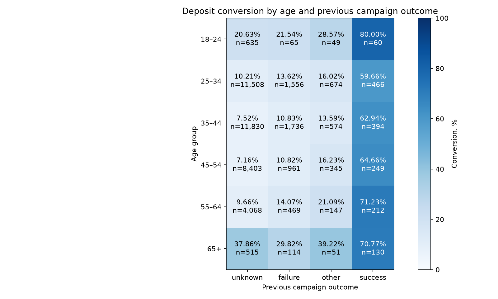

# Сохраняется ли связь с прошлым успехом внутри возрастных групп?

## Метод

Разбили записи на шесть возрастных групп и внутри каждой отдельно сравнили четыре значения `poutcome`. Категория `unknown` сохранена: она не означает доказанную неудачу. Наблюдения не удалялись. Полная таблица, включая `other`, находится в age_by_previous_campaign.csv. Возрастные интервалы независимо рассчитаны в SQL через CASE; агрегаты сверены с pandas.

## Результаты

| Возраст | Успех ранее: конверсия (оформления / записи) | Неудача ранее | Неизвестный результат |
|---|---:|---:|---:|
| 18–24 | 80.00% (48 / 60) | 21.54% (14 / 65) | 20.63% (131 / 635) |
| 25–34 | 59.66% (278 / 466) | 13.62% (212 / 1556) | 10.21% (1175 / 11508) |
| 35–44 | 62.94% (248 / 394) | 10.83% (188 / 1736) | 7.52% (890 / 11830) |
| 45–54 | 64.66% (161 / 249) | 10.82% (104 / 961) | 7.16% (602 / 8403) |
| 55–64 | 71.23% (151 / 212) | 14.07% (66 / 469) | 9.66% (393 / 4068) |
| 65+ | 70.77% (92 / 130) | 29.82% (34 / 114) | 37.86% (195 / 515) |

В каждой возрастной группе конверсия при `success` выше, чем при любом из остальных результатов. Внутри `success` она составляет 59,66–80,00%. У молодых клиентов с прошлым успехом всего 60 записей, поэтому показатель 80% не стоит интерпретировать как устойчивое преимущество именно этой возрастной группы.

## Проверка возрастного состава

Возрастная стандартизация применяет ко всем четырём результатам одинаковые веса возрастных групп — их доли в полной выборке. Взвешиваются не округлённые конверсии. Это описательная проверка на уровне выбранных шести интервалов; состав внутри интервалов и другие признаки она не учитывает.

Для `success` исходная конверсия 64,73%, стандартизованная — 63,63%; для `failure` — 12,61% и 12,59%; для `unknown` — 9,16% и 9,30%. Значит, различие возрастного состава в этих интервалах не объясняет всю наблюдаемую связь с прошлым успехом.

## Вывод и следующий шаг

Предыдущий успешный результат — кандидат для дальнейшей проверки при планировании кампании. Следующий шаг: проверить, сохраняется ли связь на более позднем независимом периоде и при сравнении клиентов с похожими характеристиками. Прямую причинную интерпретацию исключаем: прошлый успех может отражать склонность клиентов к продукту, условия прошлых предложений и отбор аудитории.

Данные не являются рандомизированным экспериментом; клиентского идентификатора нет, поэтому нельзя проверить независимость записей. В рамках этой проверки не рассчитаны p-value и не заявлена статистическая значимость. Расходы и доходы неизвестны, так что прибыльность стратегии не оценена.
